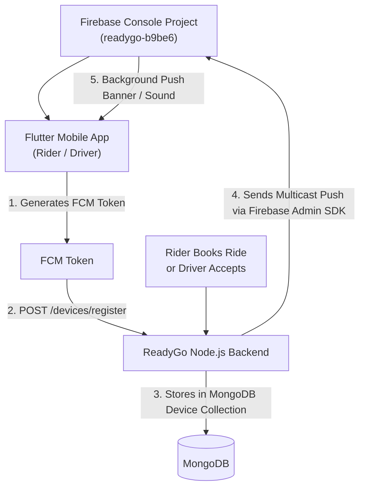

# ReadyGo - Flutter Push Notification (FCM) Integration Guide

A complete, production-ready guide for the Frontend / Flutter Mobile Developer to set up Firebase Cloud Messaging (FCM) background and foreground push notifications for **Rider** and **Driver** mobile apps.

---

## 📋 Table of Contents
1. [Architecture Overview](#1-architecture-overview)
2. [Package Dependencies](#2-package-dependencies)
3. [Android & iOS Native Configuration](#3-android--ios-native-configuration)
4. [Backend Device Registration APIs](#4-backend-device-registration-apis)
5. [Complete Flutter Dart Implementation](#5-complete-flutter-dart-implementation)
6. [Payload Structure Sent by Backend](#6-payload-structure-sent-by-backend)
7. [Screen Navigation on Notification Click](#7-screen-navigation-on-notification-click)
8. [Testing & Troubleshooting Checklist](#8-testing--troubleshooting-checklist)

---

## 1. Architecture Overview



---

## 2. Package Dependencies

Add the following dependencies to your `pubspec.yaml`:

```yaml
dependencies:
  flutter:
    sdk: flutter
  firebase_core: ^3.10.0
  firebase_messaging: ^15.2.0
  flutter_local_notifications: ^18.0.1
  device_info_plus: ^11.2.0 # To extract unique hardware deviceId
  http: ^1.2.2
```

Run:
```bash
flutter pub get
```

---

## 3. Android & iOS Native Configuration

### Android Configuration

#### A. Place `google-services.json`
Download `google-services.json` from Firebase Console (Project: `readygo-b9be6`) and place it inside:
```
android/app/google-services.json
```

#### B. Update `android/build.gradle` (Project Level)
```groovy
buildscript {
    dependencies {
        classpath 'com.google.gms:google-services:4.4.2'
    }
}
```

#### C. Update `android/app/build.gradle` (App Level)
```groovy
apply plugin: 'com.android.application'
apply plugin: 'com.google.gms.google-services' // Add at the bottom or inside plugins block

android {
    defaultConfig {
        minSdkVersion 21 // Minimum required for FCM
        targetSdkVersion 34
    }
}
```

#### D. Update `android/app/src/main/AndroidManifest.xml`
Add inside `<manifest>`:
```xml
<uses-permission android:name="android.permission.INTERNET"/>
<uses-permission android:name="android.permission.VIBRATE"/>
<uses-permission android:name="android.permission.WAKE_LOCK"/>
<!-- Required for Android 13+ (API 33+) -->
<uses-permission android:name="android.permission.POST_NOTIFICATIONS"/>
```

Add inside `<application>`:
```xml
<!-- Default Notification Icon & Color -->
<meta-data
    android:name="com.google.firebase.messaging.default_notification_icon"
    android:resource="@mipmap/ic_launcher" />
<meta-data
    android:name="com.google.firebase.messaging.default_notification_color"
    android:resource="@color/white" />

<!-- Notification Channel for High Priority Heads-up Popups -->
<meta-data
    android:name="com.google.firebase.messaging.default_notification_channel_id"
    android:value="readygo_high_importance_channel" />
```

---

### iOS Configuration (If Applicable)

1. Place `GoogleService-Info.plist` inside `ios/Runner/`.
2. In Xcode, enable:
   - **Push Notifications** (under Signing & Capabilities).
   - **Background Modes** -> check **Remote notifications** and **Background fetch**.

---

## 4. Backend Device Registration APIs

Jab user login kare, mobile app ko apna **FCM Token** backend ko bhejna hota hai taaki backend use us user ki ID ke sath link kar sake.

### A. Rider Device Registration
- **Endpoint:** `POST /api/v1/devices/register`
- **Headers:** 
  ```http
  Authorization: Bearer <RIDER_JWT_TOKEN>
  Content-Type: application/json
  ```
- **Request Body:**
  ```json
  {
    "deviceId": "samsung_sm_g998b_uuid123",
    "platform": "android",
    "pushToken": "eXamPle_fcm_t0ken_123456789..."
  }
  ```

---

### B. Driver Device Registration
- **Endpoint:** `POST /api/v1/driver/devices/register` (or `POST /api/v1/driver/auth/device`)
- **Headers:** 
  ```http
  Authorization: Bearer <DRIVER_JWT_TOKEN>
  Content-Type: application/json
  ```
- **Request Body:**
  ```json
  {
    "deviceId": "redmi_note12_uuid456",
    "platform": "android",
    "pushToken": "eXamPle_fcm_t0ken_987654321..."
  }
  ```

---

## 5. Complete Flutter Dart Implementation

Create a file: `lib/services/notification_service.dart`:

```dart
import 'dart:convert';
import 'dart:io';
import 'package:flutter/foundation.dart';
import 'package:firebase_core/firebase_core.dart';
import 'package:firebase_messaging/firebase_messaging.dart';
import 'package:flutter_local_notifications/flutter_local_notifications.dart';
import 'package:device_info_plus/device_info_plus.dart';
import 'package:http/http.dart' as http;

/// TOP-LEVEL FUNCTION: Background message handler must be outside any class!
@pragma('vm:entry-point')
Future<void> _firebaseMessagingBackgroundHandler(RemoteMessage message) async {
  await Firebase.initializeApp();
  debugPrint("🔔 [FCM Background Handler] Title: ${message.notification?.title}");
  debugPrint("🔔 [FCM Background Handler] Data: ${message.data}");
}

class NotificationService {
  static final NotificationService _instance = NotificationService._internal();
  factory NotificationService() => _instance;
  NotificationService._internal();

  final FirebaseMessaging _fcm = FirebaseMessaging.instance;
  final FlutterLocalNotificationsPlugin _localNotifications = FlutterLocalNotificationsPlugin();

  static const AndroidNotificationChannel _channel = AndroidNotificationChannel(
    'readygo_high_importance_channel', // id
    'ReadyGo Live Trip Notifications', // title
    description: 'High importance notifications for ride booking and driver assignment',
    importance: Importance.max,
    playSound: true,
    enableVibration: true,
    // Tip: To play custom sound like Rapido/Uber, place 'trip_alert.mp3' in 'android/app/src/main/res/raw/' and uncomment:
    // sound: RawResourceAndroidNotificationSound('trip_alert'),
  );

  /// 1. Initialize FCM and Local Notifications
  Future<void> initNotificationService({
    required Function(Map<String, dynamic> data) onNotificationClick,
  }) async {
    // Background handler register
    FirebaseMessaging.onBackgroundMessage(_firebaseMessagingBackgroundHandler);

    // Request permissions (Android 13+ & iOS)
    NotificationSettings settings = await _fcm.requestPermission(
      alert: true,
      badge: true,
      sound: true,
      provisional: false,
    );

    if (settings.authorizationStatus == AuthorizationStatus.authorized) {
      debugPrint(' User granted notification permission');
    } else {
      debugPrint(' User declined or has not accepted permission');
    }

    // Android Local Notification Settings
    const AndroidInitializationSettings androidSettings =
        AndroidInitializationSettings('@mipmap/ic_launcher');

    const DarwinInitializationSettings iosSettings = DarwinInitializationSettings();

    const InitializationSettings initSettings = InitializationSettings(
      android: androidSettings,
      iOS: iosSettings,
    );

    await _localNotifications.initialize(
      initSettings,
      onDidReceiveNotificationResponse: (NotificationResponse response) {
        if (response.payload != null) {
          final data = jsonDecode(response.payload!);
          onNotificationClick(data);
        }
      },
    );

    // Create high importance notification channel for Android heads-up alerts
    await _localNotifications
        .resolvePlatformSpecificImplementation<AndroidFlutterLocalNotificationsPlugin>()
        ?.createNotificationChannel(_channel);

    // 2. Handle FOREGROUND notifications (When App is open on screen)
    FirebaseMessaging.onMessage.listen((RemoteMessage message) {
      debugPrint(" Received Foreground Push: ${message.notification?.title}");

      RemoteNotification? notification = message.notification;
      AndroidNotification? android = message.notification?.android;

      if (notification != null && android != null && !kIsWeb) {
        _localNotifications.show(
          notification.hashCode,
          notification.title,
          notification.body,
          NotificationDetails(
            android: AndroidNotificationDetails(
              _channel.id,
              _channel.name,
              channelDescription: _channel.description,
              importance: Importance.max,
              priority: Priority.high,
              icon: '@mipmap/ic_launcher',
              playSound: true,
            ),
          ),
          payload: jsonEncode(message.data),
        );
      }
    });

    // 3. Handle NOTIFICATION CLICK when app was in BACKGROUND
    FirebaseMessaging.onMessageOpenedApp.listen((RemoteMessage message) {
      debugPrint(" App opened via Background Notification Tap: ${message.data}");
      onNotificationClick(message.data);
    });

    // 4. Handle NOTIFICATION CLICK when app was completely TERMINATED / KILLED
    RemoteMessage? initialMessage = await _fcm.getInitialMessage();
    if (initialMessage != null) {
      debugPrint(" App launched from KILLED state via Notification Tap: ${initialMessage.data}");
      onNotificationClick(initialMessage.data);
    }
  }

  /// 2. Get Unique Device ID
  Future<String> getDeviceId() async {
    final deviceInfo = DeviceInfoPlugin();
    if (Platform.isAndroid) {
      final androidInfo = await deviceInfo.androidInfo;
      return androidInfo.id; // Unique hardware ID
    } else if (Platform.isIOS) {
      final iosInfo = await deviceInfo.iosInfo;
      return iosInfo.identifierForVendor ?? "ios_unknown_device";
    }
    return "unknown_device_${DateTime.now().millisecondsSinceEpoch}";
  }

  /// 3. Get FCM Token & Register to ReadyGo Backend
  Future<void> registerDeviceTokenToBackend({
    required String authToken,
    required bool isDriver,
    required String backendBaseUrl, // e.g. "https://api.readygo.com" or "http://10.0.2.2:5000"
  }) async {
    try {
      String? token = await _fcm.getToken();
      if (token == null) {
        debugPrint("❌ Failed to get FCM Token");
        return;
      }
      debugPrint(" FCM Device Token: $token");

      final String deviceId = await getDeviceId();
      final String platform = Platform.isAndroid ? "android" : "ios";

      final endpoint = isDriver
          ? "$backendBaseUrl/api/v1/driver/devices/register"
          : "$backendBaseUrl/api/v1/devices/register";

      final response = await http.post(
        Uri.parse(endpoint),
        headers: {
          "Authorization": "Bearer $authToken",
          "Content-Type": "application/json",
        },
        body: jsonEncode({
          "deviceId": deviceId,
          "platform": platform,
          "pushToken": token,
        }),
      );

      if (response.statusCode == 200 || response.statusCode == 201) {
        debugPrint(" Device Token Registered successfully to ReadyGo Backend!");
      } else {
        debugPrint("❌ Backend token register failed: ${response.statusCode} - ${response.body}");
      }

      // Listen for FCM token refresh (e.g. app reinstall or Google rotation)
      _fcm.onTokenRefresh.listen((newToken) {
        debugPrint("🔄 FCM Token Refreshed: $newToken");
        registerDeviceTokenToBackend(
          authToken: authToken,
          isDriver: isDriver,
          backendBaseUrl: backendBaseUrl,
        );
      });
    } catch (e) {
      debugPrint("❌ Exception registering device token: $e");
    }
  }
}
```

---

### Integrating in `main.dart`:

```dart
import 'package:flutter/material.dart';
import 'package:firebase_core/firebase_core.dart';
import 'services/notification_service.dart';

void main() async {
  WidgetsFlutterBinding.ensureInitialized();
  await Firebase.initializeApp();

  // Initialize notifications
  await NotificationService().initNotificationService(
    onNotificationClick: (Map<String, dynamic> data) {
      handleNotificationNavigation(data);
    },
  );

  runApp(const ReadyGoApp());
}

final GlobalKey<NavigatorState> navigatorKey = GlobalKey<NavigatorState>();

void handleNotificationNavigation(Map<String, dynamic> data) {
  final String? type = data['type'];
  final String? rideId = data['rideId'];

  debugPrint("🚦 Navigating to Screen for type: $type, rideId: $rideId");

  if (type == 'RIDE_OFFER' && rideId != null) {
    // For Driver App: Open Incoming Trip Offer Screen
    navigatorKey.currentState?.pushNamed('/ride-offer', arguments: {'rideId': rideId});
  } else if (type == 'DRIVER_ASSIGNED' && rideId != null) {
    // For Rider App: Open Live Tracking Screen with driver details
    navigatorKey.currentState?.pushNamed('/live-tracking', arguments: {'rideId': rideId});
  } else if (type == 'DRIVER_ARRIVED' && rideId != null) {
    // For Rider App: Show Driver Arrived Sheet
    navigatorKey.currentState?.pushNamed('/live-tracking', arguments: {'rideId': rideId});
  } else if (type == 'TRIP_COMPLETED' && rideId != null) {
    // For Rider App: Open Fare Receipt & Rating Screen
    navigatorKey.currentState?.pushNamed('/trip-receipt', arguments: {'rideId': rideId});
  }
}
```

---

## 6. Payload Structure Sent by Backend

Backend har event par standard Notification + Custom Data payload bhejta hai:

### A. Jab Rider Ride Book Karta Hai (Sent to Online Drivers):
```json
{
  "notification": {
    "title": "🚖 New Ride Request!",
    "body": "Pickup: Connaught Place • Drop: Noida Sector 62 • Fare: ₹250"
  },
  "data": {
    "rideId": "6648fabc1290...",
    "type": "RIDE_OFFER",
    "fareAmount": "250",
    "screen": "RideOfferScreen"
  }
}
```

### B. Jab Driver Ride Accept Karta Hai (Sent to Rider):
```json
{
  "notification": {
    "title": "✅ Driver Assigned!",
    "body": "Rahul Sharma accepted your ride (Hero Splendor - DL 01 AB 1234). Arriving in 3 mins."
  },
  "data": {
    "rideId": "6648fabc1290...",
    "driverId": "6648fa391091...",
    "type": "DRIVER_ASSIGNED",
    "screen": "LiveRideTrackingScreen"
  }
}
```

### C. Jab Driver Pickup Location Par Pahunche (Sent to Rider):
```json
{
  "notification": {
    "title": "📍 Driver Arrived!",
    "body": "Rahul Sharma has arrived at the pickup location."
  },
  "data": {
    "rideId": "6648fabc1290...",
    "type": "DRIVER_ARRIVED",
    "screen": "LiveRideTrackingScreen"
  }
}
```

### D. Jab Trip Complete Ho Jaye (Sent to Rider):
```json
{
  "notification": {
    "title": "🏁 Trip Completed!",
    "body": "You have reached your destination. Total fare: ₹250. Thank you for riding with ReadyGo!"
  },
  "data": {
    "rideId": "6648fabc1290...",
    "type": "TRIP_COMPLETED",
    "screen": "RideReceiptScreen"
  }
}
```

---

## 7. Screen Navigation on Notification Click

Notification par click hone par `message.data` se `type` check karke target screen par navigate karein:

| Notification `type` | App Target Screen | Description |
| :--- | :--- | :--- |
| `RIDE_OFFER` | `RideOfferScreen` (Driver App) | Driver can view pickup, drop, fare and Accept/Reject |
| `DRIVER_ASSIGNED` | `LiveRideTrackingScreen` (Rider App) | Shows Driver profile, phone, vehicle plate, ETA |
| `DRIVER_ARRIVED` | `LiveRideTrackingScreen` (Rider App) | Notifies rider that driver is waiting outside |
| `TRIP_COMPLETED` | `RideReceiptScreen` (Rider App) | Shows final breakdown & driver rating dialog |

---

## 8. Testing & Troubleshooting Checklist

### 1. Android 13+ Notification Permission
Android 13 (API 33)+ par user ko system popup aayega `Allow ReadyGo to send you notifications?`.  
Ensure `requestPermission()` is called early in app startup.

### 2. Chinese OEM Devices (Xiaomi, Vivo, Oppo, OnePlus)
In devices par background processes restrict hoti hain. User ko advise karein:
- **Settings -> Apps -> ReadyGo -> Autostart: ENABLE**
- **Battery Optimization: Don't Optimize / No Restrictions**

### 3. Verification from Postman / Backend Console
Jab aap device register kar denge:
1. Rider account se `POST /api/v1/rides` call karein.
2. Backend console me dekhenge:
   ```
   [FCM] Push sent to user 6648...: 1 succeeded, 0 failed
   ```
3. Driver ke phone par screen lock hone par bhi sound aur banner ke sath **"🚖 New Ride Request!"** pop-up hoga!

