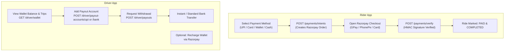

# ReadyGo - Complete Payment & Wallet Integration Guide (Rider & Driver Apps)

A complete, production-grade guide for the Frontend / Flutter Mobile Developer to implement:
1. **Rider App:** Razorpay Online Payments (UPI, Cards, NetBanking), Wallet Top-up, and Cash payment.
2. **Driver App:** Driver Wallet, Daily Earnings, Adding Bank/UPI Payout Accounts, and Withdrawal/Payout Requests.

---

## 📋 Table of Contents
1. [Payment Architecture for Rider & Driver](#1-payment-architecture-for-rider--driver)
2. [Package Dependencies (`pubspec.yaml`)](#2-package-dependencies-pubspecyaml)
3. [Android & iOS Native Configuration](#3-android--ios-native-configuration)
4. [PART 1: Rider App Payment Implementation](#4-part-1-rider-app-payment-implementation)
   - [A. Ride Fare Payment (Razorpay Checkout)](#a-ride-fare-payment-razorpay-checkout)
   - [B. Rider Wallet Top-up](#b-rider-wallet-top-up)
   - [C. Complete Rider Payment Service (Flutter Dart)](#c-complete-rider-payment-service-flutter-dart)
5. [PART 2: Driver App Financial Implementation](#5-part-2-driver-app-financial-implementation)
   - [A. View Driver Wallet & Daily Earnings](#a-view-driver-wallet--daily-earnings)
   - [B. Add Payout Destination (Bank Account / UPI)](#b-add-payout-destination-bank-account--upi)
   - [C. Request Withdrawal / Payout](#c-request-withdrawal--payout)
   - [D. Driver Wallet Recharge via Razorpay](#d-driver-wallet-recharge-via-razorpay)
   - [E. Complete Driver Wallet Service (Flutter Dart)](#e-complete-driver-wallet-service-flutter-dart)
6. [Razorpay Test Mode Credentials](#6-razorpay-test-mode-credentials)
7. [Common Pitfalls & Troubleshooting](#7-common-pitfalls--troubleshooting)

---

## 1. Payment Architecture for Rider & Driver



---

## 2. Package Dependencies (`pubspec.yaml`)

Add these to both **Rider** and **Driver** `pubspec.yaml`:

```yaml
dependencies:
  flutter:
    sdk: flutter
  razorpay_flutter: ^1.3.7  # For Razorpay checkout dialog
  http: ^1.2.2              # For Backend REST APIs
```

Run in terminal:
```bash
flutter pub get
```

---

## 3. Android & iOS Native Configuration

### Android Setup

#### A. Update `android/app/build.gradle`
Razorpay requires `minSdkVersion 19` or higher:
```groovy
android {
    defaultConfig {
        minSdkVersion 19 // or 21+
        targetSdkVersion 34
    }
}
```

#### B. Update `android/app/proguard-rules.pro` (Required to prevent Release APK crashes)
```proguard
-keepclassmembers class * {
    @android.webkit.JavascriptInterface <methods>;
}
-keepattributes JavascriptInterface
-keepattributes *Annotation*
-dontwarn com.razorpay.**
-keep class com.razorpay.** {*;}
-optimizations !method/inlining/
```

And in `android/app/build.gradle`:
```groovy
buildTypes {
    release {
        minifyEnabled true
        proguardFiles getDefaultProguardFile('proguard-android-optimize.txt'), 'proguard-rules.pro'
    }
}
```

---

### iOS Setup (If Applicable)

In `ios/Podfile`:
```ruby
platform :ios, '12.0'
```
Run:
```bash
cd ios && pod install
```

---

## 4. PART 1: Rider App Payment Implementation

### A. Ride Fare Payment (Razorpay Checkout)

#### Step 1: Create Order
- **URL:** `POST /api/v1/payments/intents`
- **Headers:**
  ```http
  Authorization: Bearer <RIDER_TOKEN>
  Content-Type: application/json
  ```
- **Request Body:**
  ```json
  {
    "purpose": "RIDE_PAYMENT",
    "rideId": "6648fabc12903847291a92e1",
    "amountPaise": 25000,
    "paymentMethodId": "upi"
  }
  ```
  *(Note: ₹250 = `25000` paise. Always multiply rupees by `100`).*

- **Response:**
  ```json
  {
    "success": true,
    "data": {
      "paymentId": "6648fc12...",
      "amountPaise": 25000,
      "amount": 250,
      "keyId": "rzp_test_XXXXXXXXXX",
      "orderId": "order_NXyz1234567890"
    }
  }
  ```

#### Step 2: Open Razorpay Checkout & Verify Signature
After the rider pays in Razorpay checkout, Razorpay returns:
- `razorpay_order_id`
- `razorpay_payment_id`
- `razorpay_signature`

Call backend to verify:
- **URL:** `POST /api/v1/payments/verify`
- **Request Body:**
  ```json
  {
    "paymentId": "6648fc12...",
    "razorpay_order_id": "order_NXyz1234567890",
    "razorpay_payment_id": "pay_NXyz9876543210",
    "razorpay_signature": "4a7b6c5d8e9f..."
  }
  ```
- **Response:** Status `SUCCEEDED`, Ride status updated to `PAID`.

---

### B. Rider Wallet Top-up
- **URL:** `POST /api/v1/payments/intents`
- **Request Body:**
  ```json
  {
    "purpose": "WALLET_TOPUP",
    "amountPaise": 50000,
    "paymentMethodId": "upi"
  }
  ```
- Once verified via `POST /api/v1/payments/verify`, money is credited to the rider's wallet balance!

---

### C. Complete Rider Payment Service (Flutter Dart)

Create `lib/services/rider_payment_service.dart` in Rider App:

```dart
import 'dart:convert';
import 'package:flutter/material.dart';
import 'package:http/http.dart' as http;
import 'package:razorpay_flutter/razorpay_flutter.dart';

class RiderPaymentService {
  static final RiderPaymentService _instance = RiderPaymentService._internal();
  factory RiderPaymentService() => _instance;
  RiderPaymentService._internal();

  late Razorpay _razorpay;
  String? _currentPaymentId;
  String? _backendBaseUrl;
  String? _authToken;

  Function(String paymentId, String gatewayPaymentId)? _onSuccess;
  Function(String errorDescription)? _onFailure;

  void init({required String backendBaseUrl, required String authToken}) {
    _backendBaseUrl = backendBaseUrl;
    _authToken = authToken;

    _razorpay = Razorpay();
    _razorpay.on(Razorpay.EVENT_PAYMENT_SUCCESS, _handlePaymentSuccess);
    _razorpay.on(Razorpay.EVENT_PAYMENT_ERROR, _handlePaymentError);
    _razorpay.on(Razorpay.EVENT_EXTERNAL_WALLET, _handleExternalWallet);
  }

  void dispose() {
    _razorpay.clear();
  }

  /// Start Ride Payment
  Future<void> payForRide({
    required String rideId,
    required int amountRupees,
    required String riderName,
    required String riderPhone,
    required String riderEmail,
    required Function(String paymentId, String gatewayPaymentId) onSuccess,
    required Function(String error) onFailure,
  }) async {
    _onSuccess = onSuccess;
    _onFailure = onFailure;

    try {
      final int amountPaise = amountRupees * 100;

      // 1. Create order on backend
      final orderRes = await http.post(
        Uri.parse("$_backendBaseUrl/api/v1/payments/intents"),
        headers: {
          "Authorization": "Bearer $_authToken",
          "Content-Type": "application/json",
        },
        body: jsonEncode({
          "purpose": "RIDE_PAYMENT",
          "rideId": rideId,
          "amountPaise": amountPaise,
          "paymentMethodId": "upi",
        }),
      );

      final resData = jsonDecode(orderRes.body)['data'];
      _currentPaymentId = resData['paymentId'];
      final String orderId = resData['orderId'] ?? resData['razorpayOrderId'];
      final String keyId = resData['keyId'] ?? "";

      // 2. Open Razorpay Checkout
      var options = {
        'key': keyId,
        'amount': amountPaise,
        'name': 'ReadyGo Cabs',
        'description': 'Ride Fare Payment #$rideId',
        'order_id': orderId,
        'timeout': 300,
        'prefill': {
          'contact': riderPhone,
          'email': riderEmail,
          'name': riderName,
        },
        'theme': {'color': '#059669'},
      };

      _razorpay.open(options);
    } catch (e) {
      onFailure(e.toString());
    }
  }

  Future<void> _handlePaymentSuccess(PaymentSuccessResponse response) async {
    try {
      // 3. Verify signature on backend
      final verifyRes = await http.post(
        Uri.parse("$_backendBaseUrl/api/v1/payments/verify"),
        headers: {
          "Authorization": "Bearer $_authToken",
          "Content-Type": "application/json",
        },
        body: jsonEncode({
          "paymentId": _currentPaymentId,
          "razorpay_order_id": response.orderId,
          "razorpay_payment_id": response.paymentId,
          "razorpay_signature": response.signature,
        }),
      );

      if (verifyRes.statusCode == 200) {
        _onSuccess?.call(_currentPaymentId ?? "", response.paymentId ?? "");
      } else {
        _onFailure?.call("Payment verification failed on server");
      }
    } catch (e) {
      _onFailure?.call(e.toString());
    }
  }

  void _handlePaymentError(PaymentFailureResponse response) {
    _onFailure?.call(response.message ?? "Payment failed or cancelled");
  }

  void _handleExternalWallet(ExternalWalletResponse response) {
    debugPrint("External wallet: ${response.walletName}");
  }
}
```

---

## 5. PART 2: Driver App Financial Implementation

In ride-hailing apps, **Drivers receive earnings and withdraw money** to their Bank / UPI account.

### A. View Driver Wallet & Daily Earnings
- **URL:** `GET /api/v1/driver/wallet`
- **Headers:** `Authorization: Bearer <DRIVER_TOKEN>`
- **Response:**
  ```json
  {
    "success": true,
    "data": {
      "availableBalancePaise": 483250,
      "availableBalance": 4832.50,
      "currency": "INR",
      "lastCredited": {
        "amountPaise": 30650,
        "type": "TRIP_PAYOUT"
      }
    }
  }
  ```

- **Transaction Ledger:** `GET /api/v1/driver/wallet/transactions`
  Returns all completed trip credits and bank withdrawal debits.

---

### B. Add Payout Destination (Bank Account / UPI)

Drivers must add their Bank Account or UPI ID where they want to withdraw money.

#### 1. Add UPI ID:
- **URL:** `POST /api/v1/driver/payout-accounts/upi`
- **Request Body:**
  ```json
  {
    "upiId": "drivername@okhdfcbank"
  }
  ```
- **Response:**
  ```json
  {
    "success": true,
    "data": {
      "destinationId": "6648fe31...",
      "type": "UPI",
      "maskedUpiId": "dr***@okhdfcbank",
      "verificationStatus": "VERIFIED"
    }
  }
  ```

#### 2. Add Bank Account:
- **URL:** `POST /api/v1/driver/payout-accounts/bank`
- **Request Body:**
  ```json
  {
    "accountHolderName": "Ramesh Kumar",
    "accountNumber": "987654321000",
    "ifscCode": "HDFC0001234"
  }
  ```
- **Response:** Returns `destinationId` with masked account details.

---

### C. Request Withdrawal / Payout
Jab driver apni earnings bank ya UPI me transfer karna chahe:
- **URL:** `POST /api/v1/driver/payouts`
- **Request Body:**
  ```json
  {
    "amountPaise": 200000,
    "destinationId": "6648fe31...",
    "mode": "INSTANT"
  }
  ```
  *(Note: ₹2,000 = `200000` paise).*
- **Response:** Payout request created and amount debited from driver wallet.

---

### D. Driver Wallet Recharge via Razorpay
Agar driver ka balance negative ho jata hai (platform commission ke kaaran) ya driver balance topup karna chahe:
- Driver `POST /api/v1/payments/intents` with `purpose: "WALLET_TOPUP"` call karega, aur same Razorpay popup se recharge kar sakta hai!

---

### E. Complete Driver Wallet Service (Flutter Dart)

Create `lib/services/driver_wallet_service.dart` in Driver App:

```dart
import 'dart:convert';
import 'package:flutter/foundation.dart';
import 'package:http/http.dart' as http;

class DriverWalletService {
  final String backendBaseUrl;
  final String driverToken;

  DriverWalletService({required this.backendBaseUrl, required this.driverToken});

  Map<String, String> get _headers => {
        "Authorization": "Bearer $driverToken",
        "Content-Type": "application/json",
      };

  /// 1. Fetch Wallet Balance
  Future<Map<String, dynamic>?> getWalletBalance() async {
    final res = await http.get(
      Uri.parse("$backendBaseUrl/api/v1/driver/wallet"),
      headers: _headers,
    );
    if (res.statusCode == 200) {
      return jsonDecode(res.body)['data'];
    }
    return null;
  }

  /// 2. Fetch Payout Accounts (Bank / UPI)
  Future<List<dynamic>> getPayoutAccounts() async {
    final res = await http.get(
      Uri.parse("$backendBaseUrl/api/v1/driver/payout-accounts"),
      headers: _headers,
    );
    if (res.statusCode == 200) {
      return jsonDecode(res.body)['data'] ?? [];
    }
    return [];
  }

  /// 3. Add UPI ID for Withdrawal
  Future<bool> addUpiDestination(String upiId) async {
    final res = await http.post(
      Uri.parse("$backendBaseUrl/api/v1/driver/payout-accounts/upi"),
      headers: _headers,
      body: jsonEncode({"upiId": upiId}),
    );
    return res.statusCode == 200 || res.statusCode == 201;
  }

  /// 4. Add Bank Account for Withdrawal
  Future<bool> addBankDestination({
    required String accountHolderName,
    required String accountNumber,
    required String ifscCode,
  }) async {
    final res = await http.post(
      Uri.parse("$backendBaseUrl/api/v1/driver/payout-accounts/bank"),
      headers: _headers,
      body: jsonEncode({
        "accountHolderName": accountHolderName,
        "accountNumber": accountNumber,
        "ifscCode": ifscCode,
      }),
    );
    return res.statusCode == 200 || res.statusCode == 201;
  }

  /// 5. Request Payout / Money Withdrawal
  Future<bool> requestPayout({
    required int amountRupees,
    required String destinationId,
    String mode = "INSTANT", // INSTANT or STANDARD
  }) async {
    final res = await http.post(
      Uri.parse("$backendBaseUrl/api/v1/driver/payouts"),
      headers: _headers,
      body: jsonEncode({
        "amountPaise": amountRupees * 100, // ₹ to Paise
        "destinationId": destinationId,
        "mode": mode,
      }),
    );
    return res.statusCode == 200 || res.statusCode == 201;
  }
}
```

---

## 6. Razorpay Test Mode Credentials

For testing transactions in development:
1. Obtain Test Keys from [Razorpay Dashboard](https://dashboard.razorpay.com/) -> Settings -> API Keys.
2. Put in ReadyGo Backend `.env`:
   ```env
   RAZORPAY_KEY_ID=rzp_test_XXXXXXXXXX
   RAZORPAY_KEY_SECRET=YYYYYYYYYYYYYYYYYY
   ```
3. Test Payment Details:
   - **UPI:** Use any virtual VPA (e.g., `success@razorpay`).
   - **Card:** Use Razorpay Test Card numbers (e.g. `4111 1111 1111 1111`, any future expiry date, CVV `123`, OTP `123456`).
   - **NetBanking:** Select any Bank and click "Success".

---

## 7. Common Pitfalls & Troubleshooting

1. **Amount Format (Rupees vs. Paise):**
   - Razorpay accepts amounts in **Paise**. ₹100 = `10000`. Always multiply amount in rupees by `100`.
2. **Release APK Crash:**
   - If Razorpay dialog fails to open or crashes on Release APK, ensure `proguard-rules.pro` has Razorpay rules added (Section 3B).
3. **Signature Verification Failure (400 Bad Request):**
   - Signature verification requires `RAZORPAY_KEY_SECRET` in `.env`. Ensure the secret matches the key used to create the order.
4. **Driver vs. Rider Payment Flow:**
   - **Rider App:** Pays for rides & tops up wallet via Razorpay Checkout.
   - **Driver App:** Views earnings ledger & withdraws money to Bank/UPI (`POST /driver/payouts`).
