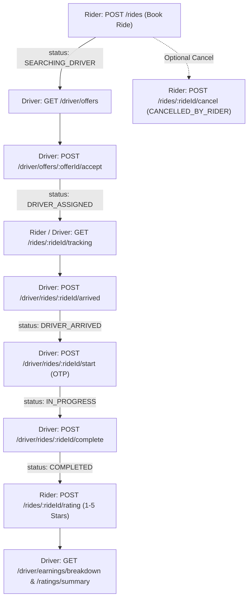

# 🚕 ReadyGo - Full Frontend & Backend Integration Documentation

Is documentation me **ReadyGo** ke **Rider (Customer)** aur **Driver (Partner)** dono ke complete postman endpoints, request payloads, response models aur step-by-step lifecycles diye gaye hain.

---

## ⚙️ 1. Base Configuration & Global Variables

* **Base URL:** `http://localhost:5000/api/v1`
* **Postman Collection File:** [readygo_collection.json](file:///C:/Users/DELL/Downloads/ReadyGo_Backend_Starter/readygo_collection.json)
* **Auth Format:** `Authorization: Bearer <token>`

### 📌 Postman Global Variables:
| Variable Name | Default Value | Description |
| :--- | :--- | :--- |
| `baseUrl` | `http://localhost:5000/api/v1` | Server API prefix |
| `riderToken` | *(Auto-saved)* | Rider JWT Access Token |
| `driverToken` | *(Auto-saved)* | Driver JWT Access Token |
| `rideId` | *(Auto-saved)* | Current active ride `_id` |
| `offerId` | *(Auto-saved)* | Active ride offer `_id` |
| `ratingId` | `rating_123` | Rating ID for details/reporting |
| `incentiveId` | `inc_daily_10` | Incentive target ID |

---

## 🔄 2. Complete Ride Lifecycle Flow



---

## 🟢 SECTION 1: `RiderPage(User)` Workflow

---

### 📱 MODULE 1.1: `auth` (Rider Authentication)

> **Flow:** Phone Input ➡️ `otp/send` ➡️ `Verify OTP` (Auto-saves `{{riderToken}}`) ➡️ `Register` (FCM) ➡️ `Refresh Token` ➡️ `Logout`

#### 1. `POST /auth/otp/send`
* **Purpose:** Mobile par 6-digit OTP send karta hai.
* **Headers:** No Auth
* **Body:**
  ```json
  {
    "countryCode": "+91",
    "phone": "9877665543",
    "purpose": "login"
  }
  ```
* **Dev Note:** Terminal me `[DEV OTP] +919877665543: <OTP>` print hota hai.

#### 2. `POST /auth/otp/verify`
* **Purpose:** OTP verify karke session start karta hai aur `riderToken` deta hai.
* **Body:**
  ```json
  {
    "countryCode": "+91",
    "phone": "9877665543",
    "otp": "123456",
    "deviceId": "device_android_001",
    "role": "rider"
  }
  ```
* **Response (200 OK):**
  ```json
  {
    "success": true,
    "data": {
      "accessToken": "eyJhbGci...",
      "refreshToken": "eyJhbGci...",
      "user": { "id": "6707...", "role": "rider" }
    }
  }
  ```

#### 3. `POST /auth/switch-role`
* **Purpose:** Bina dubara OTP mangwaye Rider se Driver (ya Driver se Rider) switch karta hai.
* **Headers:** `Authorization: Bearer {{riderToken}}`
* **Body:** `{ "role": "driver" }`

---

### 👤 MODULE 1.2: `Rider Profile`

#### 1. `GET /rider/profile`
* **Headers:** `Authorization: Bearer {{riderToken}}`
* **Response:** Name, email, phone, avatarUrl, profileCompleted flag.

#### 2. `PATCH /rider/profile`
* **Body:**
  ```json
  {
    "fullName": "Rahul Sharma",
    "email": "rahul@example.com",
    "avatarUrl": "https://picsum.photos/seed/2/150",
    "referralCode": "RAHUL2026"
  }
  ```

#### 3. `PATCH /rider/preferences`
* **Body:**
  ```json
  {
    "whatsAppUpdatesEnabled": true,
    "ridePushEnabled": true
  }
  ```

#### 4. `POST /rider/avatar/upload-url`
* **Body:** `{ "fileName": "my_photo.jpg", "contentType": "image/jpeg" }`
* **Response:** S3/Storage upload URL aur final `avatarUrl`.

#### 5. `GET /rider/referrals/:code/validate`
* **URL:** `GET /rider/referrals/READY2026/validate`
* **Response:** `{ "valid": true, "discountBonus": 50 }`

---

### 🗺️ MODULE 1.3: `prvc` (Map Nearby Drivers & Rates)

#### 1. `GET /drivers/nearby`
* **URL:** `GET /drivers/nearby?latitude=28.6139&longitude=77.2090&radiusKm=5`
* **Response:** Rider location ke aas paas ke available drivers with vehicle category, heading aur live distance.

#### 2. `GET /vehicle-categories/:categoryId`
* **URL:** `GET /vehicle-categories/moto`
* **Response:** Base fare, per KM rate, ETA.

---

### 🎟️ MODULE 1.4: `promotion & discount`

#### 1. `GET /promos/eligible`
* **Response:** Active discount coupons (`READY50`, `SAVE20`).

#### 2. `POST /promos/validate`
* **Body:** `{ "code": "READY50", "categoryId": "moto" }`

#### 3. `POST /rides/:rideId/promo`
* **Purpose:** Active ride par discount apply karta hai.
* **Body:** `{ "code": "READY50" }`

#### 4. `DELETE /rides/:rideId/promo`
* **Purpose:** Promo remove karke original fare restore karta hai.

---

### 🚗 MODULE 1.5: `ridebooking & lifecycle` (Booking Flow)

#### 1. `POST /rides` — [STEP 1: BOOK RIDE]
* **Headers:** `Authorization: Bearer {{riderToken}}`
* **Body:**
  ```json
  {
    "categoryId": "moto",
    "paymentMethodId": "wallet_123",
    "pickup": {
      "latitude": 28.6139,
      "longitude": 77.2090,
      "address": "Connaught Place, New Delhi"
    },
    "dropoff": {
      "latitude": 28.5355,
      "longitude": 77.3910,
      "address": "Sector 18, Noida"
    }
  }
  ```
* **Response (201 Created):**
  ```json
  {
    "success": true,
    "data": {
      "_id": "6acc84485d325612b970250d",
      "status": "SEARCHING_DRIVER",
      "fareBreakdown": { "totalPaise": 5000 }
    }
  }
  ```
  *(Yeh `_id` automatically Postman variable `{{rideId}}` me save ho jati hai).*

#### 2. `POST /rides/:rideId/cancel`
* **Body:** `{ "reason": "Change of plans" }`
* **Response:** Status ➡️ `"CANCELLED_BY_RIDER"`.

#### 3. `GET /rides/:rideId`
* **Purpose:** Live status check (`SEARCHING_DRIVER` ➡️ `DRIVER_ASSIGNED` ➡️ `COMPLETED`).

#### 4. `GET /rides/:rideId/tracking`
* **Purpose:** Driver ki moving GPS location & ETA return karta hai.

#### 5. `GET /rider/rides`
* **Purpose:** Rider ki past trip history list.

#### 6. `GET /rides/:rideId/receipt`
* **Purpose:** Final payable fare breakdown receipt.

---

### ⭐ MODULE 1.6: `Rating & Review` (Rider -> Driver)

#### 1. `GET /rides/:rideId/rating`
* **Purpose:** Ride ki existing rating check karta hai.

#### 2. `POST /rides/:rideId/rating`
* **Body:**
  ```json
  {
    "stars": 5,
    "comment": "Driver was very polite and driving was smooth!"
  }
  ```
* **Response (201 Created):** Review successfully submitted.

---

## 🟡 SECTION 2: `DriverPage` Workflow

---

### 🔑 MODULE 2.1: `auth` (Driver Login & Status)

#### 1. `POST /auth/otp/verify` (Driver Login)
* **Body:**
  ```json
  {
    "countryCode": "+91",
    "phone": "7007498699",
    "otp": "123456",
    "deviceId": "driver_device_001",
    "role": "driver"
  }
  ```
* **Result:** User ko driver role milta hai, uska `DriverProfile` active/approved hota hai, aur token `{{driverToken}}` me save hota hai.

#### 2. `PATCH /driver/availability`
* **Body:** `{ "status": "ONLINE", "vehicleCategory": "moto" }`

#### 3. `POST /driver/location`
* **Body:** `{ "latitude": 28.6139, "longitude": 77.2090, "heading": 90 }`

---

### 🚦 MODULE 2.2: `driverbooking & lifecycle` (Driver Actions)

#### 1. `GET /driver/offers` — [STEP D1: VIEW OFFERS]
* **Headers:** `Authorization: Bearer {{driverToken}}`
* **Purpose:** Nearby pending rides list karta hai jahan se `offerId` milti hai.

#### 2. `POST /driver/offers/:offerId/accept` — [STEP D2: ACCEPT]
* **URL:** `POST /driver/offers/{{offerId}}/accept`
* **Action:** Ride status ➡️ **`DRIVER_ASSIGNED`** aur driver assign ho jata hai.

#### 3. `POST /driver/offers/:offerId/reject` — [STEP D3: REJECT]
* **Body:** `{ "reason": "Too far from pickup" }`

#### 4. `POST /driver/rides/:rideId/arrived` — [STEP D4: ARRIVED AT PICKUP]
* **URL:** `POST /driver/rides/{{rideId}}/arrived`
* **Action:** Ride status ➡️ **`DRIVER_ARRIVED`**.

#### 5. `POST /driver/rides/:rideId/start` — [STEP D5: START TRIP]
* **URL:** `POST /driver/rides/{{rideId}}/start`
* **Body:** `{ "otp": "1234" }`
* **Action:** Ride status ➡️ **`IN_PROGRESS`** aur `startedAt` time record hota hai.

#### 6. `POST /driver/rides/:rideId/complete` — [STEP D6: COMPLETE TRIP]
* **URL:** `POST /driver/rides/{{rideId}}/complete`
* **Action:** Ride status ➡️ **`COMPLETED`** aur `completedAt` time record hota hai.

#### 7. `GET /driver/rides/:rideId/tracking`
* **Purpose:** Driver perspective tracking metadata.

---

### 📊 MODULE 2.3: `driverdashboard & earning`

#### 1. `GET /driver/dashboard/summary`
* **Response:** Today's trips, earnings, online hours, rating, lifetime trips.

#### 2. `GET /driver/earnings/breakdown`
* **Response:** Base fare, distance fare, surge bonus, tips, incentives, platform fee, net earnings.

#### 3. `GET /driver/earnings/daily`, `/weekly`, `/monthly`
* **Response:** Timeframe ke hisaab se earnings data.

#### 4. `GET /driver/trips?status=completed&page=1&limit=10`
* **Response:** Driver ki completed trips list.

#### 5. `GET /driver/trips/:tripId`
* **Response:** Single trip details.

#### 6. `GET /driver/incentives`
* **Response:** Active bonus goals (`inc_daily_10`, `inc_peak_rush`, `inc_weekend_hero`).

#### 7. `GET /driver/incentives/:incentiveId`
* **URL:** `GET /driver/incentives/inc_daily_10`
* **Response:** Target completion %, bonus reward (₹500), expiry date.

---

### ⭐ MODULE 2.4: `Rating & Review` (Driver Perspective)

#### 1. `GET /driver/ratings/summary?period=30d`
* **Response:** Average rating, total ratings count, 5-star se 1-star percentage breakdown.

#### 2. `GET /driver/ratings?page=1&limit=10&stars=5`
* **Response:** Riders ke comments aur reviews list.

#### 3. `GET /driver/ratings/:ratingId`
* **URL:** `GET /driver/ratings/rating_123`
* **Response:** Single rating details.

#### 4. `POST /driver/ratings/:ratingId/report`
* **Body:** `{ "reason": "abusive", "description": "Abusive comment" }`
* **Response:** Review moderation status ➡️ `"UNDER_REVIEW"`.

---

### 📈 MODULE 2.5: `DriverPerformancestatus`

#### 1. `GET /driver/performance?period=30d`
* **Response:** Driver Score (0-100), Pilot Tier (`PRO_PILOT` / `PILOT`), completion rate, cancellation rate.

#### 2. `GET /driver/performance/score-breakdown`
* **Response:** Score calculation criteria.

#### 3. `GET /driver/performance/trends?period=week`
* **Response:** Performance graph trend.

#### 4. `GET /driver/performance/shifts`
* **Response:** Driver shift analytics.

---

## ⚡ 3. Realtime Socket.IO Events Reference

| Event Name | Direction | Payload Keys | Description |
| :--- | :--- | :--- | :--- |
| `ride:status` | Server ➡️ Client | `rideId`, `status`, `changedAt` | Ride state transition update |
| `ride:driver_assigned` | Server ➡️ Rider | `rideId`, `driverId`, `vehicle`, `etaMinutes` | Driver details when offer is accepted |
| `ride:location` | Server ➡️ Rider | `rideId`, `latitude`, `longitude`, `heading` | Moving car marker on map |
| `driver:offer` | Server ➡️ Driver | `offerId`, `rideId`, `pickup`, `dropoff`, `fare` | Nearby new ride dispatch popup |
| `safety:sos_status` | Server ➡️ All | `eventId`, `status`, `updatedAt` | SOS emergency trigger |
| `payment:status` | Server ➡️ Rider | `paymentId`, `status`, `amountPaise` | Trip payment completed |
